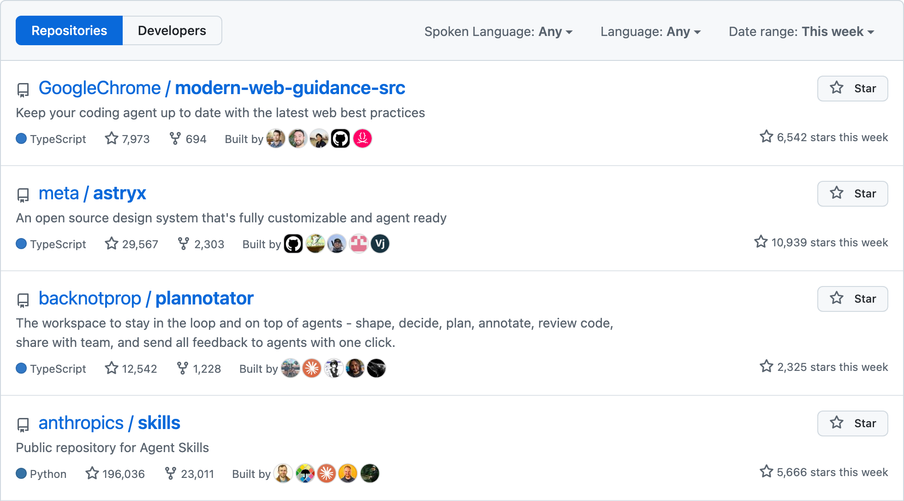
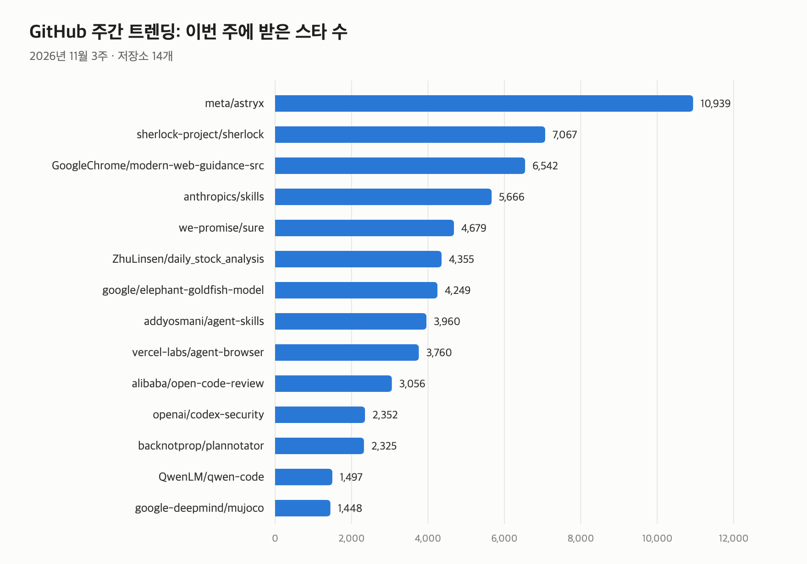

# GitHub Trends (11월 3주)

지난주 글 마지막에 "다음 주에도 같은 리파지토리들이 남아 있는지 확인해보겠다"고 적었습니다. 확인해보니 14개 중에 남은 것은 두 개뿐이네요. [anthropics/skills](https://github.com/anthropics/skills)와 [vercel-labs/agent-browser](https://github.com/vercel-labs/agent-browser)이고, 나머지 열두 개는 전부 새 얼굴입니다.

분위기도 조금 달라졌습니다. 지난주가 "에이전트에게 무엇을 쥐여줄 것인가"였다면, 이번 주는 큰 회사들이 사내에서 쓰던 것을 꺼내놓은 주에 가깝습니다. Google, Meta, Alibaba, OpenAI의 이름이 한 화면에 같이 보입니다. ( Google은 조직 세 곳의 이름으로 세 개가 올라와 있습니다. )

<!-- more -->

### [1. GoogleChrome / modern-web-guidance-src](https://github.com/GoogleChrome/modern-web-guidance-src)

이번 주 6,542개의 스타를 받은 TypeScript 리파지토리입니다. 코딩 에이전트에게 요즘 웹 플랫폼 사용법을 알려주는 스킬 모음이고, 이 리파지토리는 그 스킬을 작성하고 평가하는 소스 쪽입니다.

문제의식이 재미있습니다. 모델의 학습 데이터에는 오래된 코드가 훨씬 많아서, 에이전트는 지금은 브라우저가 기본으로 제공하는 기능도 예전 방식의 JavaScript로 길게 짜버린다는 것입니다. 그래서 Popover API, 컨테이너 쿼리, View Transitions 같은 최근 몇 년의 기능을 짧은 가이드로 만들어 에이전트의 컨텍스트에 넣어줍니다. 모델이 이미 아는 내용은 평가를 돌려서 가이드에서 덜어낸다고 합니다.

`npx modern-web-guidance@latest install`로 설치하고, `legacy-scan` 명령으로 기존 코드에서 낡은 패턴을 찾아볼 수도 있습니다. Chrome, Edge, Firefox, MDN 팀이 함께 관리한다고 적혀 있는 것이 눈에 띄네요. 올해 1월에 만들어진 리파지토리이고 Apache 2.0 라이선스입니다.

### [2. meta / astryx](https://github.com/meta/astryx)

순위는 2위인데 이번 주에 받은 스타는 10,939개로 가장 많습니다. Meta가 공개한 디자인 시스템입니다. README에 따르면 사내에서 8년 동안 자라면서 13,000개가 넘는 앱에 쓰였다고 합니다.

React 19 이상에서 동작하고 150개가 넘는 컴포넌트, 테마, 다크 모드, CLI가 한 묶음으로 들어 있습니다. 스타일은 StyleX로 작성되어 있지만 쓰는 쪽에서는 `className`에 Tailwind든 일반 CSS든 원하는 것을 넣어 덮어쓸 수 있습니다. 더 깊이 고치고 싶으면 컴포넌트 소스를 통째로 내 프로젝트로 꺼내오는 기능도 있습니다.

여기에도 "사람과 에이전트가 같은 방식으로 만든다"는 문장이 들어 있습니다. API와 문서, CLI를 에이전트도 같이 읽는다는 전제로 설계했다는 것인데, 이제 디자인 시스템 소개에도 빠지지 않는 문장이 된 것 같습니다. 아직 베타이고 MIT 라이선스입니다.

### [8. sherlock-project / sherlock](https://github.com/sherlock-project/sherlock)

7,067개의 스타를 받은 Python 리파지토리입니다. 사용자 이름 하나를 넣으면 400개가 넘는 소셜 네트워크에서 같은 이름의 계정을 찾아줍니다. `sherlock user123` 한 줄이 사용법의 전부입니다.

새 프로젝트가 아니라는 것이 재미있습니다. 2018년 12월에 만들어졌고 전체 스타가 이미 11만 개입니다. 저희가 마지막으로 깃헙 트렌드 글을 쓰던 해에 태어난 리파지토리가 이번 주 목록에 올라와 있는 셈이네요. 왜 다시 올라왔는지는 README만 봐서는 잘 모르겠습니다.

### [9. google / elephant-goldfish-model](https://github.com/google/elephant-goldfish-model)

이름이 먼저 눈에 들어왔습니다. 4,249개의 스타를 받았고, 에이전트와 함께 설계 문서를 쓰고 리뷰하는 플러그인입니다. README의 첫 줄이 "코끼리와 설계하고, 금붕어와 리뷰하라"입니다.

코끼리는 프로젝트의 맥락을 전부 기억한 채로 명세 초안을 씁니다. 금붕어는 앞선 대화를 전혀 모르는 상태에서 초안과 소스만 보고 리뷰합니다. 맥락을 다 아는 쪽은 당연하다고 넘어간 가정을 글로 적지 않게 되는데, 아무것도 모르는 리뷰어가 그 빈자리를 찾아낸다는 것입니다. 최종 결정과 승인은 사람이 합니다.

지난주에 본 cloudflare의 보안 감사 스킬도 찾는 에이전트와 검증하는 에이전트를 나눠두었는데, 같은 생각이 설계 문서 쪽에도 온 것 같습니다. 문서와 실제 코드가 어긋난 곳을 찾아주는 명령도 있습니다. 올해 9월에 만들어졌고 Apache 2.0입니다.

### [11. alibaba / open-code-review](https://github.com/alibaba/open-code-review)

Go로 작성된 코드 리뷰 CLI이고 3,056개의 스타를 받았습니다. Alibaba 사내에서 2년 동안 수만 명의 개발자가 쓰던 도구를 공개한 것이라고 합니다.

README는 범용 에이전트에게 리뷰를 시켰을 때의 불만부터 적고 있습니다. 변경이 크면 일부 파일만 보고 넘어가고, 지적한 줄 번호가 실제 위치와 어긋나고, 프롬프트를 조금만 바꿔도 품질이 흔들린다는 것입니다. 그래서 어떤 파일을 볼지, 어떤 규칙을 적용할지, 댓글을 어느 줄에 달지처럼 틀리면 안 되는 부분은 코드로 고정하고, 판단이 필요한 부분만 에이전트에게 맡겼습니다.

벤치마크 설명이 솔직한 편입니다. 같은 모델로 범용 에이전트보다 정밀도가 높고 토큰은 9분의 1 정도만 쓰지만, 재현율은 더 낮다고 적어두었습니다. 놓치는 게 조금 있더라도 틀린 지적을 줄이는 쪽을 골랐다는 것이네요.

### [13. openai / codex-security](https://github.com/openai/codex-security)

2,352개의 스타를 받았습니다. 코드에서 취약점을 찾고, 찾은 후보를 검증하고, 패치까지 만들어주는 CLI와 TypeScript SDK입니다. `npm install --global @openai/codex-security`로 설치한 뒤 `cs scan .`으로 저장소를 훑습니다.

변경분만 보는 옵션( `--diff origin/main` )이 있어서 CI에 붙이는 쓰임새를 염두에 둔 것으로 보입니다. 결과는 SARIF, JSON, CSV로 내보내거나 Linear, Jira, GitHub 이슈로 넘길 수 있습니다. 지난주에는 Cloudflare가, 이번 주에는 OpenAI가 보안 도구를 올렸으니 이쪽도 한동안 계속 보일 것 같습니다.

### 남은 것과 새로 온 것

두 주 연속으로 남은 [anthropics/skills](https://github.com/anthropics/skills)는 5,666개를 받아 4위이고, [agent-browser](https://github.com/vercel-labs/agent-browser)는 3,760개로 5위입니다. 스킬 쪽에는 [addyosmani/agent-skills](https://github.com/addyosmani/agent-skills)( 12위 )가 새로 들어왔습니다. 지난주에 있던 스킬 모음 하나가 빠진 자리에 다른 스킬 모음이 들어온 모양새라, skills라는 단어는 이번 주에도 그대로네요.

3위 [plannotator](https://github.com/backnotprop/plannotator)는 에이전트가 계획이나 결과물을 내놓으면 브라우저에 띄워서 사람이 주석을 달고 되돌려 보내는 도구입니다. 2,325개를 받았습니다. 에이전트가 일을 많이 할수록 사람이 끼어들 자리를 만들어주는 도구도 같이 늘어나는 것 같습니다.

### 에이전트가 아닌 것들

지난주에는 두 개였는데 이번 주는 조금 늘었습니다. 6위 [we-promise/sure](https://github.com/we-promise/sure)는 Ruby로 작성된 개인 자산 관리 앱이고 4,679개를 받았습니다. 사업을 접은 Maybe Finance의 코드를 커뮤니티가 이어받은 포크이고, Docker로 직접 호스팅해서 씁니다. README의 뒷이야기에 개발비로 100만 달러 가까이 들었던 앱이라고 적혀 있습니다.

10위 [google-deepmind/mujoco](https://github.com/google-deepmind/mujoco)는 물리 시뮬레이터이고 1,448개를 받았습니다. 앞에서 본 sherlock까지 합치면 에이전트 없이 설명되는 것이 세 개입니다. ( 7위 [daily_stock_analysis](https://github.com/ZhuLinsen/daily_stock_analysis)는 주식 분석 도구인데 설명란에 LLM 기반이라고 적혀 있어서 세지 않았습니다. )

### 지난주와 비교해보면

이번 주에 받은 스타 수를 모아서 그려봤습니다.

지난주에는 2018년의 1위였던 deno의 8,792개를 넘은 리파지토리가 여섯 개였는데, 이번 주는 astryx 하나입니다. 한 주 만에 목록이 거의 다 바뀌고 숫자도 이만큼 달라지는 걸 보면, 지난주가 유난히 뜨거웠던 것일 수도 있겠습니다. 몇 주 더 모아봐야 알 수 있을 것 같네요.

끝.
