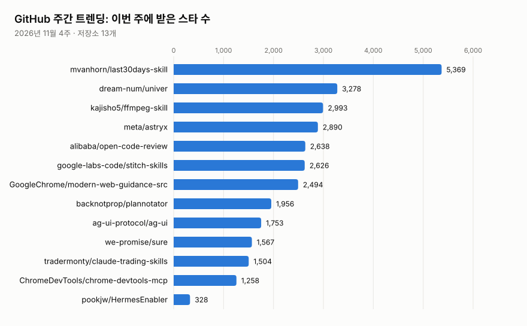

# GitHub Trends (11월 4주)

지난주에는 14개 중에 두 개만 남아서 "한 주 만에 거의 다 바뀐다"고 적었는데, 이번 주는 조금 다릅니다. 13개 중에 다섯 개가 지난주에도 있던 리파지토리네요. [plannotator](https://github.com/backnotprop/plannotator), [modern-web-guidance-src](https://github.com/GoogleChrome/modern-web-guidance-src), [open-code-review](https://github.com/alibaba/open-code-review), [astryx](https://github.com/meta/astryx), [sure](https://github.com/we-promise/sure)입니다. ( 반대로 지난주까지 두 주 연속으로 남아 있던 anthropics/skills와 agent-browser는 이번 주에 둘 다 빠졌습니다. )

새로 올라온 여덟 개를 보면 이번 주는 에이전트에게 "손"을 달아주는 주에 가깝습니다. 브라우저를 들여다보게 하고, 영상을 자르게 하고, 스프레드시트를 고치게 하고, 디자인 도구를 다루게 하는 것들이 한 화면에 모여 있습니다. 숫자는 지난주보다 한결 차분해졌습니다.

<!-- more -->

### [2. google-labs-code / stitch-skills](https://github.com/google-labs-code/stitch-skills)

이번 주 2,626개의 스타를 받은 TypeScript 리파지토리입니다. Google의 디자인 도구인 Stitch를 코딩 에이전트가 다룰 수 있게 해주는 스킬과 플러그인 모음이고, Stitch MCP 서버와 함께 쓰도록 만들어져 있습니다.

플러그인은 `stitch-design`, `stitch-build`, `stitch-utilities` 세 묶음으로 나뉘어 있어서 디자인 쪽 스킬과 컴포넌트를 만드는 쪽 스킬을 따로 골라 설치할 수 있습니다. README의 대부분이 에이전트별 설치 방법이라는 것이 눈에 띄네요. Codex, Claude Code, Cursor, OpenCode마다 설치 명령이 따로 적혀 있습니다.

Agent Skills라는 공개 표준을 따른다고 맨 첫 줄에 적어둔 것도 요즘 스킬 리파지토리들의 공통점인 것 같습니다. 올해 1월에 만들어졌고 Apache 2.0 라이선스입니다.

### [5. mvanhorn / last30days-skill](https://github.com/mvanhorn/last30days-skill)

순위는 5위인데 이번 주에 받은 스타는 5,369개로 가장 많습니다. 전체 스타도 7만 개가 넘는 Python 리파지토리입니다. 주제 하나를 던지면 Reddit, X, YouTube, Hacker News, Polymarket 같은 곳에서 최근 30일 동안의 이야기를 찾아 하나의 요약으로 묶어주는 스킬입니다.

README의 한 줄 소개가 재미있습니다. "편집자가 아니라 추천 수와 좋아요, 그리고 실제 돈으로 점수를 매기는 검색 엔진"이라고 합니다. 아무도 읽지 않은 블로그 글보다 추천을 1,500개 받은 Reddit 글이 더 강한 신호라는 것이고, Polymarket의 배당률까지 근거로 삼는 것이 독특하네요.

만든 이유도 적혀 있습니다. AI 쪽은 매일 바뀌는데 모델의 학습 데이터는 커뮤니티가 이미 알아낸 것보다 늘 몇 달씩 늦어서 만들었다고 합니다. 지난주의 modern-web-guidance와 문제의식이 닮았다는 생각이 들었습니다. ( 그쪽은 가이드를 써서 넣어주고, 이쪽은 그때그때 검색해서 넣어주는 차이가 있습니다. ) 올해 1월에 만들어졌고 MIT 라이선스입니다.

### [6. ChromeDevTools / chrome-devtools-mcp](https://github.com/ChromeDevTools/chrome-devtools-mcp)

1,258개의 스타를 받은 TypeScript 리파지토리입니다. 코딩 에이전트가 실제로 떠 있는 Chrome을 조작하고 들여다볼 수 있게 해주는 도구이고, MCP 서버와 CLI 두 가지 형태로 제공됩니다.

단순히 페이지를 클릭해주는 것에 그치지 않고 DevTools가 하는 일을 에이전트에게 넘겨준다는 것이 핵심인 것 같습니다. 성능 트레이스를 기록해서 개선할 점을 뽑아내고, 네트워크 요청과 콘솔 메시지를 확인하고, 스크린샷을 찍습니다. 자동화는 puppeteer로 한다고 적혀 있습니다.

README에 주의 사항이 꽤 앞쪽에 나옵니다. 브라우저 안의 내용이 MCP 클라이언트에 그대로 노출되니 민감한 정보를 띄워두지 말라는 것과, 사용 통계 수집이 기본으로 켜져 있어서 끄려면 `--no-usage-statistics` 옵션을 줘야 한다는 것입니다. 작년 9월에 만들어졌고 전체 스타는 6만 개에 가깝습니다.

### [8. ag-ui-protocol / ag-ui](https://github.com/ag-ui-protocol/ag-ui)

1,753개의 스타를 받았습니다. 도구가 아니라 프로토콜입니다. AI 에이전트를 사용자가 보는 화면에 연결하는 방식을 하나로 맞추자는 것이고, 이름도 Agent-User Interaction Protocol입니다.

README의 설명이 이해하기 쉬웠습니다. 에이전트는 요청 한 번에 응답 한 번이라는 모델에 맞지 않는다는 것입니다. 토큰을 흘려보내고, 응답 도중에 도구를 부르고, 사람의 확인을 기다리며 멈추고, 하위 에이전트를 만들어내는데, 프레임워크마다 그 방식이 전부 다릅니다. AG-UI는 이것을 타입이 정해진 이벤트의 흐름 하나로 바꿉니다.

이번 주에 올라온 이유는 README 상단의 안내로 짐작할 수 있을 것 같습니다. 1.0이 나왔고 명세가 확정되었다고 합니다. TypeScript, Python, .NET SDK를 그 명세에서 생성하고, 0.x와 1.0이 서로 호환된다고 적혀 있네요. 작년 5월에 만들어졌고 MIT 라이선스입니다.

### [12. dream-num / univer](https://github.com/dream-num/univer)

3,278개로 이번 주에 두 번째로 많은 스타를 받은 TypeScript 리파지토리입니다. 내 제품 안에 스프레드시트나 문서 같은 오피스 편집 기능을 넣을 수 있게 해주는 SDK입니다.

2022년에 만들어져 전체 스타가 3만 개를 넘는 프로젝트인데, 지금의 소개 문구는 "사람과 에이전트를 위한" 오피스 SDK입니다. 에이전트도 사람이 쓰는 것과 같은 API로 시트를 편집하고 계산하고 저장한다는 것이네요. 지난주 astryx의 "사람과 에이전트가 같은 방식으로 만든다"는 문장이 생각났습니다.

무엇이 오픈소스이고 무엇이 아닌지를 README에서 따로 구분해둔 점은 읽어둘 만합니다. 이 리파지토리는 Web SDK의 코어와 수식, 렌더링 엔진을 Apache 2.0으로 제공하고, 실시간 협업이나 파일 가져오기와 내보내기를 맡는 Server SDK와 AI SDK는 별도라고 합니다. 데모에는 상용 기능도 섞여 있다고 직접 적어두었습니다.

### [13. kajisho5 / ffmpeg-skill](https://github.com/kajisho5/ffmpeg-skill)

2,993개의 스타를 받은 Python 리파지토리입니다. 코딩 에이전트가 내 컴퓨터의 FFmpeg로 영상을 편집하게 해주는 스킬이고 MCP 서버로도 쓸 수 있습니다. 클라우드도 API 키도 필요 없고 `ffmpeg`와 `python3`만 있으면 된다고 합니다.

README의 "왜 만들었나"가 솔직합니다. FFmpeg를 "안다"는 에이전트도 결국은 추측을 한다는 것입니다. 프레임 레이트를 넘겨짚고, 컨테이너에 담을 수 없는 코덱을 고르고, 결과 파일을 열어보지도 않고 "끝났다"고 보고합니다. 그래서 작업은 항상 원본 파일을 측정하는 것에서 시작하고, 끝난 뒤에는 실제로 쓰인 파일의 길이와 화면 크기, 오디오를 다시 확인하게 해두었습니다.

에이전트가 셸 명령 문자열을 직접 쓰지 않고 `--aspect 9:16` 같은 이름 있는 옵션만 넘기면 도구가 FFmpeg 명령을 조립한다는 점도 눈에 띕니다. 지난주 open-code-review가 틀리면 안 되는 부분을 코드로 고정해둔 것과 같은 방향이네요. 올해 9월에 만들어졌고 MIT 라이선스입니다.

### 남은 것들

두 주 연속으로 남은 다섯 개는 순위가 많이 섞였습니다. 지난주 3위였던 [plannotator](https://github.com/backnotprop/plannotator)가 1,956개로 1위에 올라왔고, 1위였던 [modern-web-guidance-src](https://github.com/GoogleChrome/modern-web-guidance-src)는 2,494개로 3위가 되었습니다. ( 1위가 받은 스타가 3위보다 적은 것을 보면, 트렌딩의 순서는 이번에도 주간 스타 수 그대로는 아닌 것 같습니다. )

[open-code-review](https://github.com/alibaba/open-code-review)는 11위에서 4위로 올라왔고 2,638개를 받았습니다. 지난주에 10,939개로 가장 많은 스타를 받았던 [astryx](https://github.com/meta/astryx)는 2,890개로 9위입니다. 공개 직후의 열기가 한 주 만에 4분의 1 정도로 가라앉은 셈인데, 그래도 이번 주 네 번째로 많은 숫자입니다.

스킬 쪽에는 [tradermonty/claude-trading-skills](https://github.com/tradermonty/claude-trading-skills)( 7위, 1,504개 )가 새로 들어왔습니다. 개인 투자자를 위한 스킬 모음인데, README에서 매수와 매도 판단을 AI에게 맡기려는 것이 아니라 시장 점검과 위험 관리, 매매 기록을 정리하는 절차를 만들려는 것이라고 여러 번 강조하고 있습니다.

### 에이전트가 아닌 것들

이번 주는 두 개입니다. 지난주에도 있던 [we-promise/sure](https://github.com/we-promise/sure)가 1,567개를 받아 11위에 남아 있습니다. 직접 호스팅해서 쓰는 개인 자산 관리 앱입니다.

다른 하나는 10위 [pookjw/HermesEnabler](https://github.com/pookjw/HermesEnabler)입니다. 이번 주 목록에서 가장 결이 다른 리파지토리이고, Objective-C로 작성되어 있습니다. 에르메스 에디션에서만 쓸 수 있는 시계 화면을 다른 Apple Watch에서도 쓸 수 있게 해주는 앱입니다. 이번 주에 받은 스타는 328개로 가장 적지만, 에이전트라는 단어가 한 번도 나오지 않는 README가 오히려 반가웠습니다.

App Store에 있는 앱이 아니라 IPA 파일을 직접 설치하거나 Xcode로 빌드해서 넣어야 하고, watchOS 27.0부터 27.3 베타 1까지만 지원한다고 합니다. 앱을 지우기 전에 반드시 백업을 복원하라는 주의 사항과 "위험은 본인 책임"이라는 문장도 적혀 있습니다. ( README가 열 개 언어로 준비되어 있는데 한국어도 있습니다. )

### 지난주와 비교해보면

이번 주에 받은 스타 수를 모아서 그려봤습니다.

가장 많이 받은 last30days-skill이 5,369개입니다. 지난주 1등이던 astryx의 10,939개와 비교하면 절반 정도이고, 2018년의 1위였던 deno의 8,792개를 넘은 리파지토리는 이번 주에 하나도 없습니다. 2주에 여섯 개, 3주에 한 개, 이번 주에 0개이니 숫자는 계속 내려오고 있네요.

대신 2,500개에서 3,300개 사이에 다섯 개가 나란히 모여 있습니다. 하나가 크게 튀는 주가 아니라 여러 개가 고르게 받은 주였던 것 같습니다. 두 주 연속으로 남는 리파지토리가 두 개에서 다섯 개로 늘어난 것도 같은 이야기일 수 있겠습니다. 다음 주에도 이 다섯 개가 남아 있는지 보겠습니다.

끝.
